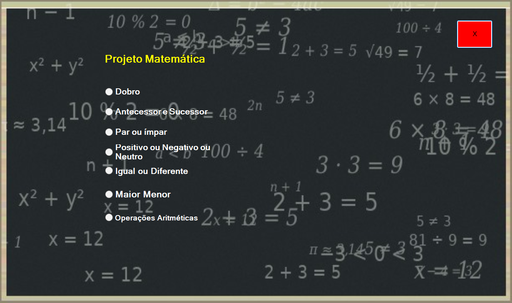
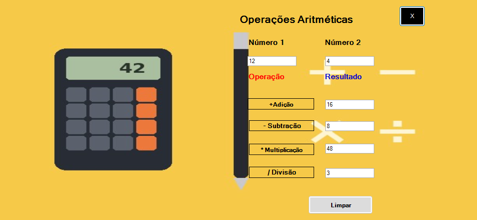
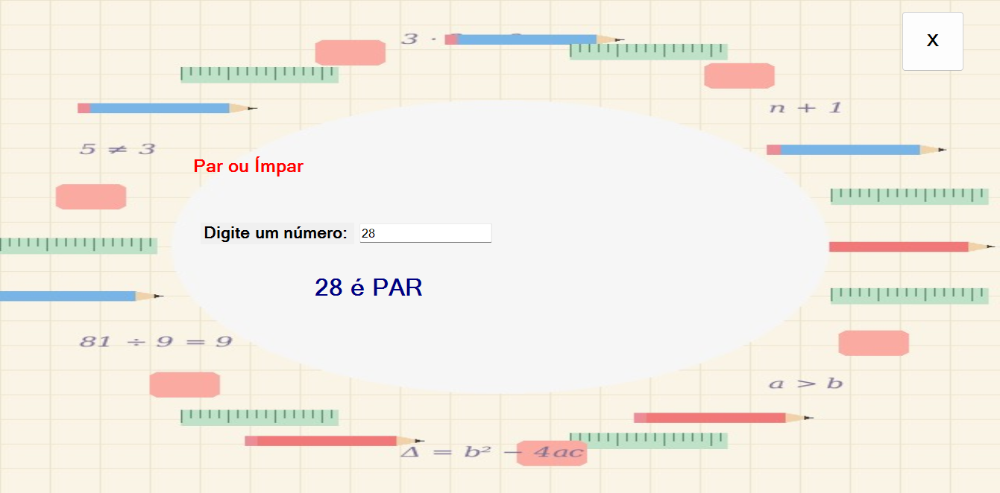
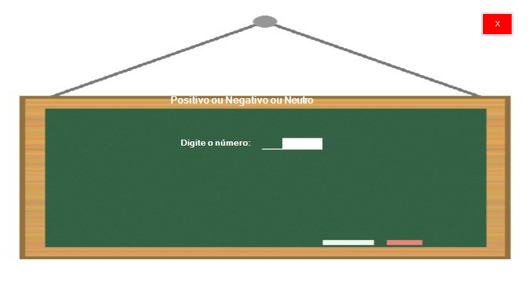
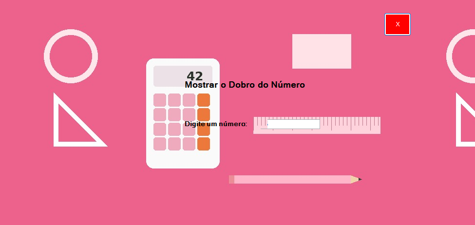
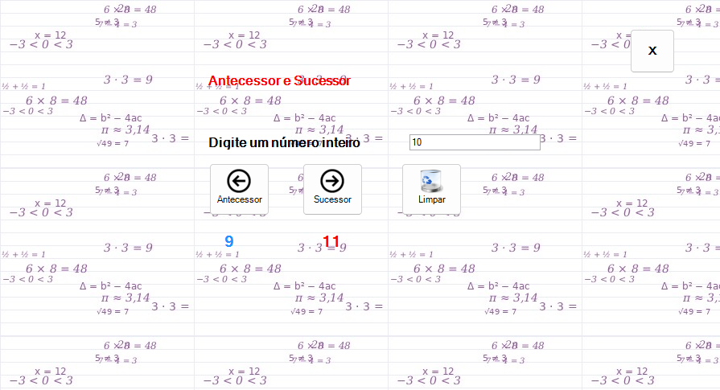
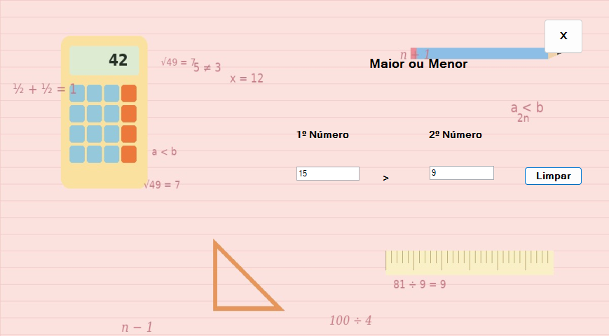
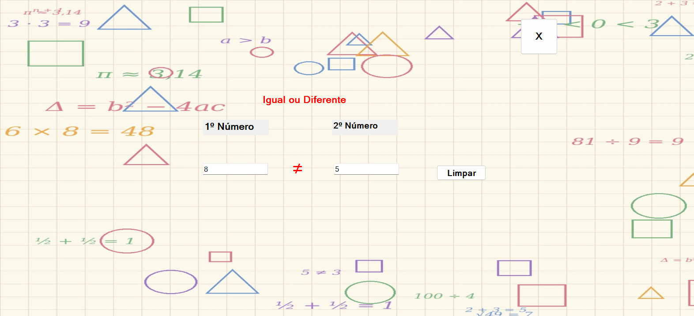

# Projeto Matemática

Aplicativo para Windows feito em **C# com Windows Forms (.NET Framework 4.7.2)** para praticar conceitos básicos de
matemática. Foi o meu primeiro projeto de programação, desenvolvido no fim do curso, e reúne o que aprendi sobre
**formulários, eventos, validação de entrada, estruturas de decisão e operações aritméticas**.

> Projeto de estudo. As imagens de fundo das telas são ilustrações próprias.

---

## Telas

### Menu principal
Escolha o exercício pelos botões de opção. A tecla **Esc** ou o botão **Sair** fecham o programa com confirmação.



### Operações aritméticas
Digite dois números e veja o resultado de **adição, subtração, multiplicação e divisão**. A divisão por zero é
bloqueada com aviso.



### Par ou ímpar
Digite um número e aperte **Enter**: o programa usa o resto da divisão por 2 (`numero % 2`) para dizer se é par ou ímpar.



### Positivo, negativo ou neutro
Aceita números negativos e informa se o valor é **positivo, negativo ou neutro (zero)**.



### Dobro
Mostra o dobro do número digitado, aceitando casas decimais.



### Antecessor e sucessor
Depois de digitar um número inteiro aparecem as setas: a da esquerda mostra o **antecessor** e a da direita o
**sucessor**. A lixeira limpa tudo.



### Maior ou menor
Compara dois números e mostra o sinal **>** ou **<** entre eles.



### Igual ou diferente
Compara dois números e mostra **=** ou **≠**.



---

## O que pratiquei neste projeto

- **Windows Forms:** vários formulários, navegação entre telas (`Show` / `Hide`), formulários sem borda e imagens de fundo
- **Eventos:** `Click`, `KeyPress` (Enter para confirmar, Esc para sair), `TextChanged` e `CheckedChanged`
- **Validação de entrada:** só aceita números (`char.IsNumber`, `char.IsControl`), campos vazios e divisão por zero
- **Estruturas de decisão:** `if / else if / else` e o operador de resto `%`
- **Tipos e conversões:** `int.Parse`, `double.Parse`, `ToString()`
- **Recursos do projeto:** imagens em `Properties.Resources` e mensagens com `MessageBox`

---

## Como executar

1. Instale o [Visual Studio](https://visualstudio.microsoft.com/) com a carga de trabalho **Desenvolvimento para desktop com .NET**.
2. Abra `Projeto Matemática.sln`.
3. Aperte **F5**.

A tela de abertura usa o controle do **Windows Media Player** (já vem no Windows) para tocar a vinheta
`vinheta-abertura-matematica.mp4`, que não está no repositório. Sem o vídeo, a abertura apenas segue para o menu.

Os prints deste README são gerados por `tools/TIRAR-PRINTS.bat`, que compila o projeto e salva uma imagem de cada tela.

---

## Estrutura

```
Form1  Frm_Abertura    tela de abertura (vinheta)
Form2  Frm_Acesso      menu principal
Form3  Frm_Positivo    positivo, negativo ou neutro
Form4  Frm_Dobro       dobro
Form5  Frm_Antecessor  antecessor e sucessor
Form6  Frm_Par         par ou ímpar
Form7  Frm_Igual       igual ou diferente
Form8  Frm_Maior       maior ou menor
Form9  Frm_Operacao    operações aritméticas
```

---

**Fábio Leite Ferreira** · [GitHub](https://github.com/fabioleiteferreira)
